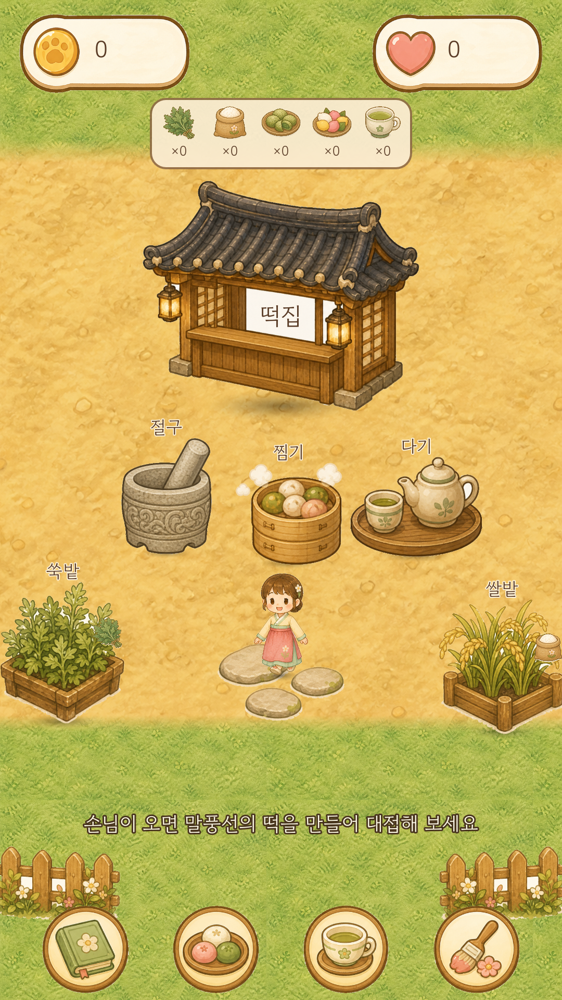

# 🏮 한옥 떡집·다방 (Hanok Teahouse)

한옥 뜰 안의 작은 떡집·다방을 꾸리는 **포근한 2D 경영 힐링 게임**입니다.
Godot **4.3** / 세로 화면(1080×1920) / 모바일 우선(GL Compatibility) / Android APK 자동 빌드.



---

## 1. 플레이 방법

| 조작 | 설명 |
| --- | --- |
| 밭(쑥밭·쌀밭) 탭 | 주인장이 걸어가서 쑥/쌀을 거둡니다 (거둔 뒤 6.5~8초 뒤 다시 자람) |
| 절구·찜기·다기 탭 | 주인장이 걸어가서 떡을 만듭니다 (진행바가 차오름) |
| 손님 탭 | 말풍선의 떡을 재고에 갖고 있으면 카운터로 걸어가 대접 → 엽전·하트 획득 |
| 빈 땅 탭 | 그 자리로 걸어갑니다 (아래/옆/위 3방향 걷기 애니메이션) |
| 하단 원형 버튼 4개 | 레시피 · 떡 보관함 · 다방 안내 · 마당 꾸미기 토글 |
| 카운터(떡집) 탭 | 레시피 팝업 |

### 레시피

| 떡 | 설비 | 재료 | 걸리는 시간 | 엽전 | 하트 |
| --- | --- | --- | --- | --- | --- |
| 쑥인절미 | 절구 | 쑥 1 + 쌀 1 | 2.6초 | 24 | 2 |
| 송편 | 찜기 | 쌀 2 | 3.0초 | 18 | 1 |
| 녹차 | 다기 | (재료 없음) | 3.4초 | 10 | 1 |

손님은 여우·고양이·오리 세 종류가 오고, 말풍선으로 주문한 뒤 인내심(45초)이 다하면 아쉬워하며 돌아갑니다.

---

## 2. 실행 방법

### 에디터에서
1. Godot **4.3** (stable)을 설치합니다.
2. 이 폴더의 `project.godot`을 엽니다.
3. F5 — 세로 화면(1080×1920)으로 실행됩니다.

### 명령줄에서
```bash
godot --path .                 # 게임 실행
godot --headless --path . --import   # 리소스 임포트(.godot 캐시 생성)
```

### 테스트
```bash
# 채집 → 제작 → 손님 응대 루프를 실제 씬에서 22개 항목으로 검증합니다.
godot --headless --path . res://tests/smoke_test.tscn
```

---

## 3. Android APK 받기 (GitHub Actions)

`main` 브랜치에 푸시하거나 Actions 탭에서 **Run workflow**를 누르면 APK가 자동으로 만들어집니다.

1. 저장소 → **Actions** 탭
2. **Android APK 빌드** 워크플로 선택 → 최근 실행 클릭
3. 아래 **Artifacts** 에서 `hanok-teahouse-android-apk` 다운로드 → `hanok-teahouse-debug.apk`

폰에서 설치: 설정 → 보안 → **출처를 알 수 없는 앱 설치** 허용 후 APK 실행 (디버그 서명 빌드입니다).

빌드 환경 요약 (`.github/workflows/build-android.yml`):
- Ubuntu + OpenJDK 17 + Android SDK (`platform-tools`, `build-tools;34.0.0`, `platforms;android-34`)
- `keytool`로 표준 `debug.keystore` 생성
- Godot **4.3-stable** 리눅스 헤드리스 + 4.3-stable export templates(`.tpz`) 설치
- `--headless --import` → `--export-debug "Android" build/hanok-teahouse-debug.apk`
- 결과를 아티팩트로 업로드

---

## 4. 프로젝트 구조

```
project.godot                 # 세로 1080×1920, canvas_items / expand, gl_compatibility
icon.png / icon.svg           # 앱 아이콘
export_presets.cfg            # Android 프리셋 (com.aleum.hanokteahouse, arm64+armv7)
.github/workflows/build-android.yml
scenes/
  Main.tscn                   # 마당 · 설비 배치 · HUD
  Shopkeeper.tscn             # 주인장 (CharacterBody2D + AnimatedSprite2D)
  Station.tscn                # 밭/설비 한 칸 (Area2D)
  Customer.tscn               # 손님 (Area2D + 말풍선)
  HUD.tscn                    # 엽전·하트·재고 · 하단 버튼 · 팝업
scripts/
  GameState.gd                # 오토로드: 엽전·하트·재고·레시피 표
  Main.gd                     # 탭 처리, 이동/채집/제작/응대 큐, 손님 스폰
  Shopkeeper.gd               # 3방향 걷기 애니메이션, 이동
  Station.gd                  # 재생 쿨다운, 제작 진행바, 배지
  Customer.gd                 # 주문 말풍선, 인내심, 입·퇴장
  HUD.gd                      # 상단 HUD, 토스트, 팝업
assets/
  sprites/  icons/  ui/  tiles/  fonts/ (고운 돋움, OFL)
tools/slice_assets.py         # 원본 아트 → 투명 PNG 슬라이싱 도구
tests/smoke_test.tscn|gd      # 헤드리스 게임플레이 검증
tests/shot.tscn|gd            # 스크린샷 캡처(개발용)
```

### 아트 파이프라인
`downloads/`의 생성 원본(크림색 배경)에서 **가장자리 플러드필 + 그림자 인식** 방식으로 배경을 지우고,
4×3 걷기 시트를 균일 셀(212×391)로 정렬해 잘라냅니다. 전역 색 임계값을 쓰지 않아 흰 쌀·오리·말풍선 속이 지워지지 않습니다.

```bash
python3 tools/slice_assets.py            # assets/ 전체 재생성
python3 tools/slice_assets.py --debug    # 세그멘테이션 박스 확인 이미지도 출력
```

---

## 5. 조정해 볼 만한 값

| 파일 | 값 |
| --- | --- |
| `scripts/GameState.gd` | `RECIPES` — 가격·하트·제작 시간·재료 |
| `scenes/Main.tscn` | 설비 위치, `art_scale`, `cooldown`, `work_offset` |
| `scripts/Main.gd` | `SLOT_X`, `SLOT_Y`(손님 대기 자리), `WALK_AREA`, 손님 스폰 간격 |
| `scripts/Customer.gd` | `patience` — 손님 인내심(초) |
| `scripts/Shopkeeper.gd` | `speed` — 걷는 속도 |

---

## 6. 라이선스 / 크레딧

- 코드·아트: 이 프로젝트용으로 제작 (아름 님)
- 폰트: **고운 돋움(Gowun Dodum)** — SIL Open Font License 1.1 (`assets/fonts/OFL.txt`)
- 엔진: Godot Engine 4.3 (MIT)
- `assets/icons/yakgwa.png`는 다음 업데이트용 예비 아이콘입니다(현재 게임에는 미사용).
